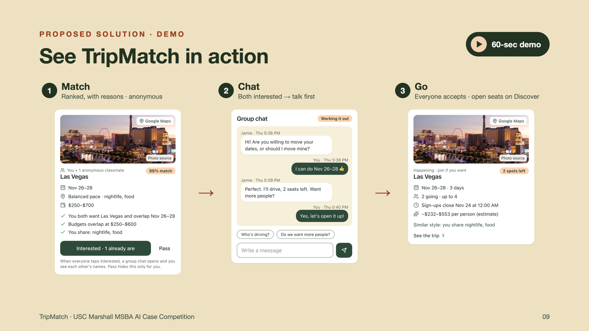
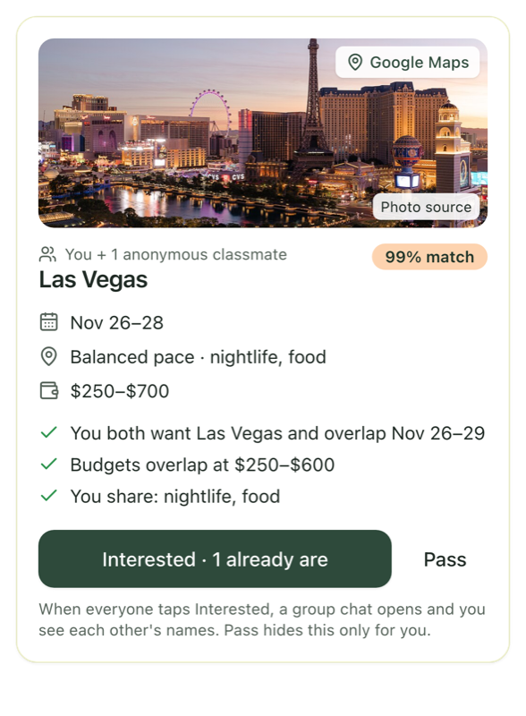
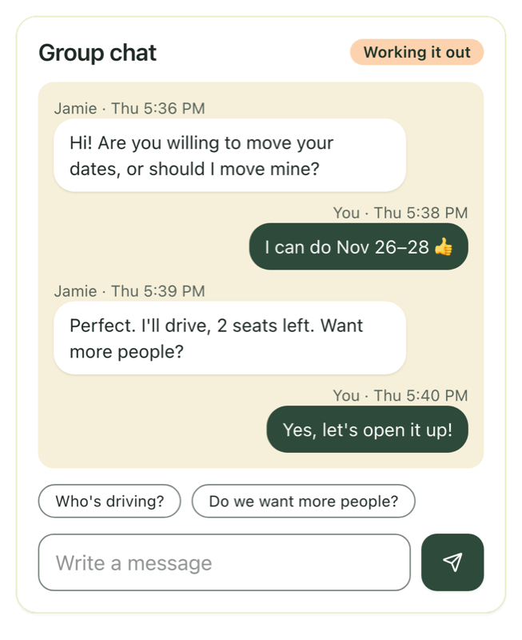
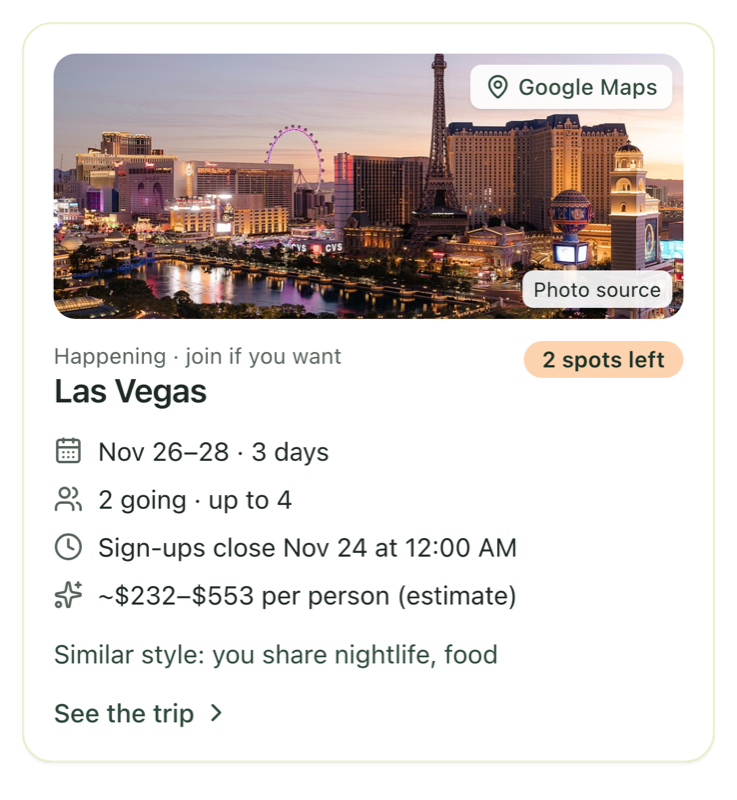

# TripMatch

**Find classmates whose travel plans almost match yours — then turn them into one trip everyone accepts.**

🏆 **1st Place — 7th Annual AI Global Business Analytics Case Competition, USC Marshall School of Business (October 2026)**

[**Live app**](https://tripmatch-msba.vercel.app) (USC sign-in) · [Developer guide](docs/DEVELOPMENT.md) · [Setup](docs/SETUP_CHECKLIST.md)



---

## The problem

About 500 USC Marshall MSBA students share the same academic calendar, yet trips keep falling apart. In our survey of 47 MSBA students (Oct 2026):

- **74%** skipped a trip in the past year because they had no one to go with
- The top reasons were coordination, not a lack of people: **no car (49%)**, **didn't know anyone interested (49%)**, **dates didn't match (43%)**
- **72%** wanted a tool to find similar plans, but **81%** worried about traveling with the wrong people

The gap isn't people. It's **visibility into whose plans almost overlap.**

## What TripMatch does

| | |
|---|---|
| **Post a plan** | Dates (a break or a few weekends), places, budget, vibe, group size. Up to 5 plans per student. |
| **Match** | Pairs and groups of 3–4, ranked by a 0–100 score, each with the reasons it fits. Anonymous until everyone is interested. |
| **Chat** | When everyone taps *Interested*, a group chat opens — talk before anyone commits. |
| **Lock the trip** | One member sends the final plan (dates, place, cost split); everyone accepts. Contacts and a calendar file unlock. |
| **Discover** | Confirmed trips can post open seats. Classmates without a plan can join instantly — and leave any time. |

<p>
  
  
  
</p>

## How it was built

1. **Discovery & research** — user segmentation, a 47-response survey, and a product hypothesis.
2. **Prototype** — first version in **Lovable** (AI no-code builder).
3. **Production app** — rebuilt with **Claude Code** (AI coding agent) for custom matching logic, real USC sign-in and database-level privacy.
4. **Voice of the customer** — 10 classmates tested the live prototype. Three changes shipped from their feedback:
   - *"Only if it's a small group"* → group-size preference (2 / 3–4 / 5–6 / any), Strict or Flexible
   - *"I'd want to talk first"* → chat opens at a mutual match, before anyone commits
   - *"What if I change my mind?"* → leave any trip; the seat reopens on Discover

## Technical highlights

- **Explainable matching engine** — hard rules (shared days, a place everyone accepts, overlapping budgets, strict group size) then a weighted score: dates 45 · destination 20 · group size 15 · budget 10 · style 10. Every score comes with its reasons. Groups of 3–4 require every pair inside to fit too. Details: [docs/images/match-score.png](docs/images/match-score.png).
- **AI itinerary with guardrails** — Claude drafts the shared itinerary from the options the rules engine has already proved feasible, and every AI suggestion is re-checked against everyone's dates, budget and destination before anyone sees it (`src/lib/ai-merge.ts`).
- **Privacy by design** — Postgres Row Level Security on every table; classmates see plans, never emails or private notes; contacts unlock only inside a confirmed trip; trip changes go through locked-down database functions (no double-booking, no race conditions).
- **Global places** — pick from popular trips or search any city worldwide; "nearby" is computed by real distance.
- **Tested** — 108 automated tests, including database tests that run the real schema in an in-memory Postgres.

**Stack:** Next.js 16 · React 19 · TypeScript · Tailwind CSS 4 · Supabase (Postgres, Auth, RLS, Storage) · Anthropic Claude API · Vercel · Vitest

```
Phone / laptop ──HTTPS──▶ Next.js on Vercel ──▶ Supabase (Postgres + Auth)
                           │ pages, server actions  │ Row Level Security on every table
                           │ matching + merge       │ trip rules in database functions
                           └ Claude (itinerary) ◀───┘ rules re-check every AI draft
```

## Team — The Seven Seas (Team A2)

USC Marshall MS in Business Analytics

- Navya Gupta
- Thomas (Jiatong) Yin — [@jiatongy-svg](https://github.com/jiatongy-svg)
- Hazel Yang
- Violet Qian
- Chaeyeon Sun
- Steven Eum

## Run it yourself

```bash
npm install
cp .env.example .env.local   # add your Supabase keys
npm run dev                  # http://localhost:3000
npm test                     # 108 tests, no keys needed
```

Full setup (Supabase, email sign-in, deployment): [docs/SETUP_CHECKLIST.md](docs/SETUP_CHECKLIST.md). Architecture, matching rules and changelog: [docs/DEVELOPMENT.md](docs/DEVELOPMENT.md).
